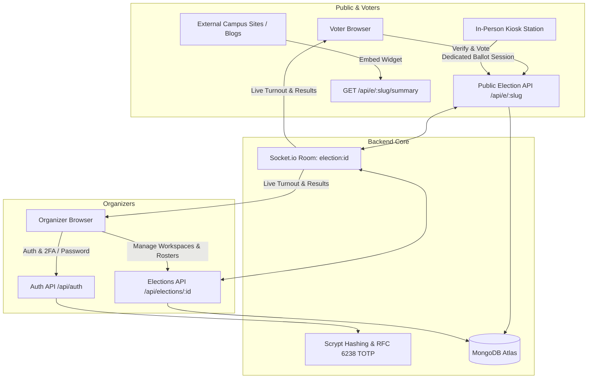
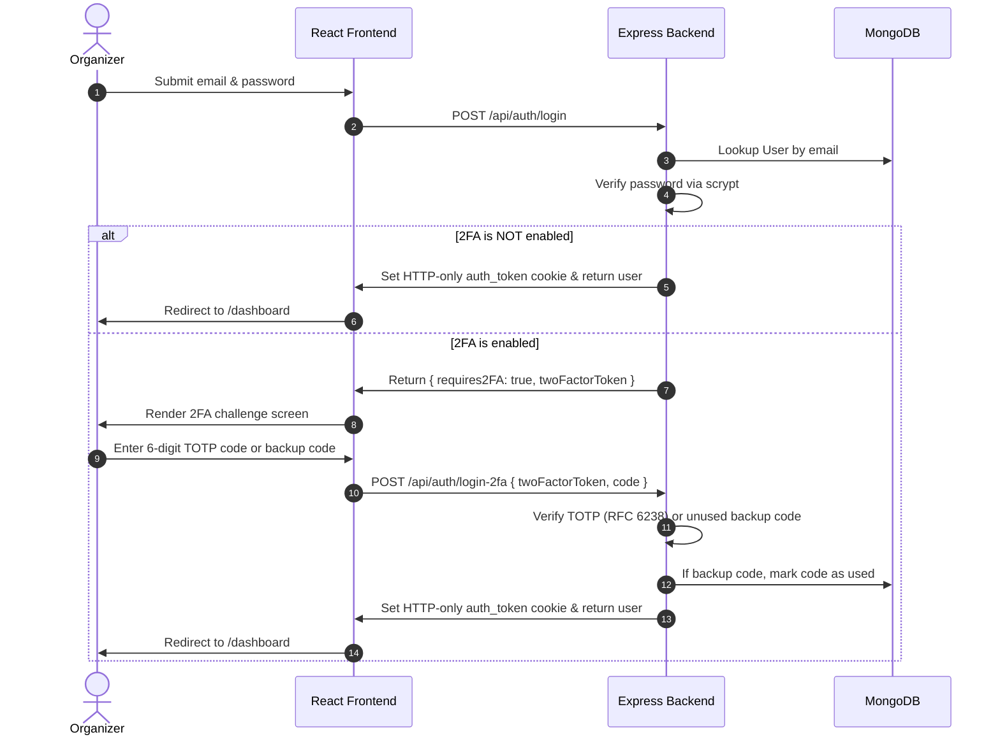

# ClassVote Architecture

This document provides a comprehensive mental model of ClassVote: how requests move through the app, multi-tenant isolation, real-time socket voting, the security architecture, and organizer authentication (including Two-Factor Authentication).

---

## 1. System Shape

ClassVote is a modern, real-time, multi-tenant voting platform built for university classes, student councils, and team elections. It is divided into three layers:

1. **Frontend**: React 19 + Vite application with Tailwind CSS, Lucide icons, Framer Motion, and HTML5 Web Audio EVM synthesis.
2. **Backend**: Express 4 REST & SEO API with Socket.io room isolation, scrypt password hashing, and RFC 6238 TOTP Two-Factor Authentication.
3. **Database**: MongoDB with Mongoose models organized around tenant isolation (`electionId` and `ownerId`).

---

## 2. Security & Authentication Architecture

### Clerk Modern Authentication & Multi-Factor Security

Organizer authentication is powered by **Clerk** ([clerk.com](https://clerk.com)) with hybrid synchronization to MongoDB:

1. **Email OTP & Passwordless Login**: Automated high-deliverability 6-digit email codes sent by Clerk without requiring local SMTP setup.
2. **1-Click Google Sign-In**: Organizers can sign in instantly using their personal or university Google accounts (`@college.edu`).
3. **Turnkey 2FA & Biometrics**: Built-in Authenticator App (TOTP), SMS, and Passkeys (Touch ID, Face ID, Windows Hello).
4. **Hybrid Database Sync**: When a user signs in via Clerk, the Express backend automatically verifies the session token and creates/links the organizer's profile in the MongoDB `User` collection. All elections and secret ballots are owned by the organizer's MongoDB identifier (`ownerId`).
5. **Drop-in UI Components**:
   - `<SignIn />` and `<SignUp />` on `/login` and `/signup` with dark glassmorphic styling matching ClassVote.
   - `<UserButton />` in the top header with a self-service account management modal.

---

## 3. Multi-Tenant Election Architecture

Elections operate in completely isolated workspaces. An organizer can run multiple independent elections without cross-contamination.

### Access Modes
Each election supports one of three access modes configured by the organizer:
* **`roster` (Roster Verified)**: Voters must match a pre-registered student record in `EligibleVoter` (Name + Enrollment Number or Email) uploaded manually or via CSV.
* **`open` (Open Link)**: Any student with a valid email or institutional ID can vote once. Duplicate prevention is enforced via unique indexes on `Voter`.
* **`kiosk_only`**: Online voter entry is disabled; votes may only be cast through physical in-person voting terminals.

### Secret Ballot Protection
ClassVote strictly enforces the **Secret Ballot Principle**:
* Attendance is recorded in the `Voter` collection (`{ electionId, name, email, votedAt }`) to prevent duplicate voting.
* Ballot choices are stored in the decoupled `Vote` collection (`{ electionId, positionId, candidateId, votedAt }`) without any reference to voter identity.
* Even administrators and organizers cannot see who voted for which candidate.

---

## 4. Frontend Application Map

* [frontend/src/App.jsx](frontend/src/App.jsx): Main router with protected route gates and dynamic layouts.
* [frontend/src/pages/LandingPage.jsx](frontend/src/pages/LandingPage.jsx): Public landing page with join code finder and organizer CTAs.
* [frontend/src/pages/LoginPage.jsx](frontend/src/pages/LoginPage.jsx): Organizer sign-in with seamless 2-step TOTP challenge and backup code fallback.
* [frontend/src/pages/SignUpPage.jsx](frontend/src/pages/SignUpPage.jsx): Organizer self-service registration.
* [frontend/src/pages/DashboardHomePage.jsx](frontend/src/pages/DashboardHomePage.jsx): Organizer multi-election management hub, account settings, and 2FA configuration modal.
* [frontend/src/pages/ElectionManagePage.jsx](frontend/src/pages/ElectionManagePage.jsx): Election console for live candidate inline editing, position management, CSV roster upload, turnout export, and widget embed snippet.
* [frontend/src/pages/EntryPage.jsx](frontend/src/pages/EntryPage.jsx): Scoped voter portal (`/e/:slug`) for roster eligibility verification.
* [frontend/src/pages/VotingPage.jsx](frontend/src/pages/VotingPage.jsx): Real-time secret ballot voting screen with candidate selection review.
* [frontend/src/pages/ResultsPage.jsx](frontend/src/pages/ResultsPage.jsx): Certified live results tally with Socket.io streaming and winner celebration.
* [frontend/src/pages/KioskPage.jsx](frontend/src/pages/KioskPage.jsx): Dedicated in-person EVM terminal with 0.5s auto-reset, single-position focus view, and sound synthesis.
* [frontend/src/pages/ElectionEmbedWidget.jsx](frontend/src/pages/ElectionEmbedWidget.jsx): Compact, responsive iframe widget (`/e/:slug/embed`) with live turnout counts and organic backlink loop.
* [frontend/src/components/TwoFactorSettingsModal.jsx](frontend/src/components/TwoFactorSettingsModal.jsx): Complete 2FA management modal (QR code scanner, manual key, code verification, backup codes generator, and disable workflow).

---

## 5. API Surface

### Authentication & 2FA (`/api/auth`)
* `POST /api/auth/register`: Register new organizer account.
* `POST /api/auth/login`: Authenticate with password (issues `twoFactorToken` if 2FA active).
* `POST /api/auth/login-2fa`: Complete 2FA challenge with 6-digit TOTP or backup code.
* `POST /api/auth/logout`: Clears session cookie.
* `GET /api/auth/me`: Get current authenticated organizer profile.
* `PUT /api/auth/profile`: Update organizer name, organization, or password.
* `POST /api/auth/2fa/setup`: Generates pending secret & `otpauth://` QR URI.
* `POST /api/auth/2fa/verify-enable`: Confirms 6-digit code, activates 2FA, and returns 8 backup codes.
* `GET /api/auth/2fa/status`: Checks active status and remaining backup code counts.
* `POST /api/auth/2fa/disable`: Disables 2FA with password + code confirmation.
* `POST /api/auth/2fa/regenerate-backup-codes`: Generates 8 fresh recovery codes.

### Organizer Election Console (`/api/elections`)
* `GET /api/elections`: List organizer's elections.
* `POST /api/elections`: Create new election workspace.
* `GET /api/elections/:id`: Fetch election details and positions.
* `PUT /api/elections/:id`: Update schedule, access mode, or title.
* `DELETE /api/elections/:id`: Delete election and all associated ballots.
* `POST /api/elections/:id/positions`: Create ballot position.
* `POST /api/elections/:id/candidates`: Register candidate with optional photo.
* `PUT /api/elections/:id/candidates/:candidateId`: Live inline candidate name edit without losing votes.
* `POST /api/elections/:id/roster`: Add single student to roster.
* `POST /api/elections/:id/upload-roster`: Bulk CSV roster ingestion.
* `GET /api/elections/:id/turnout-export`: Neutralized CSV turnout log export.

### Public Voter Portal (`/api/e/:slug`)
* `GET /api/e/:slug`: Fetch public election metadata.
* `GET /api/e/:slug/summary`: Lightweight turnout counts for embed widgets.
* `POST /api/e/:slug/verify`: Verify student identity against roster.
* `GET /api/e/:slug/positions`: Retrieve active positions and candidates.
* `POST /api/e/:slug/vote`: Submit verified secret ballot.
* `POST /api/e/:slug/kiosk-vote`: Submit physical kiosk ballot (organizer auth required).
* `GET /api/e/:slug/results`: Fetch certified results if published.

### SEO & Crawler Endpoints
* `GET /robots.txt`: Host-aware search crawler indexing rules.
* `GET /sitemap.xml`: Dynamic XML sitemap listing public elections and portals.
